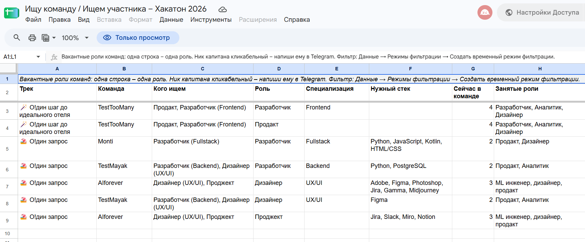

# 🧩 Teamfinder на Google Forms + Sheets – подбор команд для хакатона «Островок»

**Автор:** Тамара Воробьёва · [LinkedIn](https://www.linkedin.com/in/tamara-vorobyeva) · [GitHub](https://github.com/tamara-vorobyeva)
**Моя роль:** продакт и проджект-менеджер; работа с требованиями – задача и рамки, требования, согласование с заинтересованными сторонами, проверка и приёмка. ИИ (Claude) готовил черновики и писал код по письменным правилам работы.

> **⚠️ Дисклеймер.** Независимый проект, сделанный по собственной инициативе, чтобы помочь участникам хакатона «Островок» собрать команды. Это не официальный продукт «Островка», и я не работаю в «Островке». В репозитории нет данных участников.

> **Статус (октябрь 2026):** решение реализовано и покрыто автотестами; проверка на мобильном эккаунте Google (в роли администратора), а также на мобильных устройствах и декстопе (как участник) завершена.

**📌 Задача**
* Участникам хакатона «Островок» без команды нужна команда, а командам – люди на конкретные роли. Сейчас они ищут друг друга в общем чате Telegram, а команды оформляются в боте организатора (`/createteam`, `/invite <ID>`).
* Инструменту с заявками и приглашениями понадобились бы бэкенд, доступ к боту организатора и решения организаторов, которые ещё не приняты, – к закрытию набора команд он бы не успел.
* **Этот проект – быстрый вариант:** две анкеты («Ищу команду», «Ищем участника»), форма «Обновить статус» и публичная таблица «Ищу команду / Ищем участника» в Google Sheets с фильтрами по треку, роли, навыкам и стеку. Люди связываются напрямую в Telegram; команды по-прежнему оформляются только в боте.
* Ценность: рабочий инструмент подбора за дни, а не недели, без бэкенда, хостинга и зависимости от систем организатора.

**🎯 Цели**
* Запустить рабочий инструмент **до закрытия набора команд** (дата закрытия – открытый вопрос к организаторам).
* Выполнить два условия, которые я поставила с самого начала: **никогда не публиковать исходные ответы** и **обеспечить весь путь с телефона без VPN** – с запасным вариантом, если Google недоступен у части участников в России.
* Соблюсти правила организатора: один капитан, не больше 5 человек, команды оформляются только в боте.

**🔗 Ссылки - Решение**

📢 **Ищу команду / Ищем участника**: https://docs.google.com/spreadsheets/d/1QEfY1mZuF5XimUPmM3alQqp0zMbUUANW2L6wslbcMG4/edit

🙋Форма «Ищу команду»: 
https://forms.gle/1CAdx52QiQKT7mEr9 · 

🧑‍🤝‍🧑Форма «Ищем участника»: 
https://forms.gle/o1VkWidEr4DAQd8T9 · 

🔄 Форма «Обновить статус»: 
https://forms.gle/wirYApdQDiEuQaP76 · 

🖥️Таблица администратора (закрытая): https://docs.google.com/spreadsheets/d/1kM0UDc-ZQXc2_g2ad5OMYVZ9P-bPCQ4G3pbpEn-kA2o/edit

**🔗 Ссылки - Кейс**
🛠 **[Кейс](case-study.ru.md)** – варианты архитектуры, ключевые решения, отклонённые варианты, реестр рисков, RACI и то, как велось ТЗ
🔒 Полное ТЗ, руководство администратора и код в этом репозитории не опубликованы – доступны по запросу.

---

**🧰 Инструменты и ИИ**
* **Требования и ТЗ:** Claude (чат) – из моего минимального плана запуска в ТЗ; варианты архитектуры сравнены в таблице решений.
* **Реализация:** Claude Code – скрипт Google Apps Script по утверждённому ТЗ и письменным правилам работы.
* **Платформа:** Google Forms (3 формы с проверками и ветвлением), Google Sheets (закрытая таблица администратора и публичная таблица), Google Apps Script (создание форм и таблиц, очистка данных, триггеры).
* **Тесты:** встроенный тест-раннер Node.js – тесты правил таблицы и проверок форм, плюс дымовой тест кода таблиц на поддельных данных.
* **Контроль версий:** Git – коммиты только по явному разрешению.

---

**🧭 Как шла работа**
* **Рамки.** Я составила минимальный план запуска (две формы, таблицы, фильтры, инструкция), а более функциональные варианты – веб-каталог и Telegram Mini App с заявками – оставила в плане развития.
* **Требования.** Одно ТЗ (55 версий с журналом изменений) описывает поля форм с проверками, колонки публичной таблицы, правила очистки и идентификации, правила работы с персональными данными, матрицу проверки с телефонов, критерии приёмки, отклонённые варианты с причинами, открытые вопросы к организаторам и словарь терминов.
* **Выбор архитектуры.** Пять вариантов (Forms + Sheets + Apps Script, статический сайт, веб-приложение на Apps Script, no-code конструкторы, свой бэкенд) сравнены по скорости запуска, доступности в России без VPN, удобству на телефоне и рискам. Выбран Forms + Sheets + Apps Script.
* **Управляемая реализация.** Правила для ИИ-агента фиксируют рамки («что НЕ делается»), правила, которые код обязан соблюдать, и режим работы: *«Не придумывай – если в ТЗ этого нет, остановись и спроси»*, никаких новых файлов и коммитов без разрешения, у каждого решения в ТЗ – метка автора (организатор / продакт / предложение ИИ).
* **Проверка перед передачей.** Запуск на моём аккаунте Google с тестовыми данными и реальными телефонами, исправления, затем чистый запуск на аккаунте организатора.

---

**👩‍💼 Что я сделала сама**
* Составила минимальный план запуска и два условия к нему: исходные ответы не публикуются; весь путь проверяется на телефоне без VPN.
* Выбрала Forms + Sheets, чтобы успеть к сроку, и удержала объём в рамках Google Sheets, когда ИИ уходил в сторону веб-каталога.
* Сформулировала требования к справочнику ролей: три роли организатора (аналитик, продакт, разработчик) на верхнем уровне, плюс роли, которые участники добавляют сами (дизайнер, проджект-менеджер), и уточнения вроде фронтенд- или бэкенд-разработчика.
* Приняла продуктовые решения, записанные в ТЗ: идентификация по нику в Telegram и коду из 4 цифр, одна команда на капитана, мягкие ограничения размера команды, обновление статуса отдельной формой, подтверждение необратимых действий.
* Определила порядок развёртывания: тест на моём аккаунте, затем чистый запуск на аккаунте организатора.
* Проверяла результаты ИИ и требовала исправлений – формулировки, неясные инструкции, пробелы в руководстве администратора, файлы, созданные без запроса.
* Провела ревью ТЗ и руководства администратора: утвердила общий словарь терминов, сняла противоречия между документами и сверила живые формы с ТЗ.

**🤖 Что я сделала с ИИ**
* Черновики ТЗ, вопросов форм, правил проверки и обеих инструкций (для участников и для администратора).
* Скрипт Apps Script: один запуск `setup()` создаёт все три формы, обе таблицы, настройки и триггеры; `rebuild()` обновляет публичную таблицу после каждой анкеты и раз в 10 минут.
* Автотесты и пошаговое руководство администратора.

---

**📐 Ключевые решения и компромиссы**
* **Forms + Sheets вместо своего бэкенда** – запуск за дни; цена: в инструменте нет заявок и приглашений, люди договариваются напрямую в Telegram.
* **Две таблицы, в публичной – только значения** – публичная таблица – отдельный файл, в который попадают только разрешённые колонки в виде значений (без формул, ссылки на таблицу администратора, отметок времени, ссылок на изменение ответа и кодов). Так выполняется моё правило «исходные ответы не публикуются».
* **Apps Script вместо вложенных формул** – правила очистки (последняя анкета побеждает, статусы, модерация, приведение стека к словарю) – это обычные функции, покрытые тестами; формулы автоматически не проверить. Цена: однократное предупреждение Google «приложение не проверено» для администратора и суточный лимит триггеров (90 минут в сутки на бесплатном аккаунте); плановое обновление идёт раз в 10 минут с запасом, хотя в тесте одно обновление заняло меньше 3 секунд.
* **Без входа в Google; человек = ник в Telegram + код из 4 цифр** – настройка Google Forms «один ответ на человека» заставляет каждого входить в Google, а многие участники в России не могут или не захотят этого делать. Поэтому форма принимает сколько угодно анкет; в таблице остаётся последняя по каждому нику, а код из первой анкеты должен совпадать во всех следующих анкетах и изменениях статуса. Команда определяется по нику капитана (одна команда на капитана); название команды закрепляется за первым капитаном. Администратор может сбросить код, если сменился капитан или кто-то заполнил анкету под чужим ником.
* **Третья форма для статуса** – ссылку «Изменить ответ» сохраняют немногие; без отдельной формы таблица заполнилась бы людьми, которые уже нашли команду. Необратимые действия с командой требуют подтверждения.
* **Двухуровневый справочник ролей** – для фильтра нужны фиксированные значения; специализации дают точность и не отсекают тех, кто выбрал «разработчик, без уточнения».
* **Стек свободным текстом с приведением к словарю** – около 150 флажков на телефоне неудобны; «js», «JS» и «JavaScript» всё равно становятся одним значением.
* **Доступность в России** – перед запуском проверка с телефонов у разных операторов; запасная анкета и шаблон сообщения администратору, если Google Forms не открывается.

**✅ Результаты (на сегодня)**
* ТЗ со структурой таблиц, правилами идентификации, критериями приёмки, RACI, реестром рисков, отклонёнными вариантами, открытыми вопросами к организаторам и словарём терминов; после ревью ТЗ, руководство администратора и тексты форм согласованы между собой.
* Скрипт Google Apps Script разворачивается примерно за 40 минут: 3 формы, 2 таблицы, автоматическое обновление, модерация, сброс кода, сигнал о спаме, тестовые данные, закрытие набора одной командой.
* 47 автотестов проходят (42 теста правил, 4 теста проверок форм, 1 дымовой тест).
* Проверка с тестовыми данными на настоящем аккаунте Google и с телефонов без VPN завершена, последняя проверка не выявила багов.

---

**🔒 Код**
Код (скрипт Google Apps Script, автотесты, сборка) и руководство администратора в этом репозитории не опубликованы – доступны по запросу.

**📁 Состав репозитория**
* `README.ru.md` – описание проекта *(этот файл)*.
* `case-study.ru.md` – выдержки из ТЗ: варианты архитектуры, решения, отклонённые варианты, риски, RACI.

---

*Этот README показывает, как инструмент был задуман, описан и сделан: это процесс работы с требованиями, где ИИ – партнёр по реализации.*
