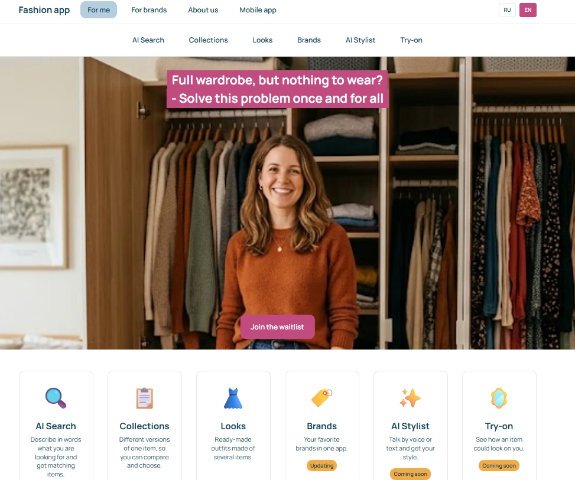

# 🎨 Fashion App — my own product idea: landing-page specification and AI-built prototype — built, published, verified.

**Author:** Tamara Vorobyeva · [LinkedIn](https://www.linkedin.com/in/tamara-vorobyeva) · [GitHub](https://github.com/tamara-vorobyeva)

> **⚠️ Disclaimer.** Self-initiated, non-commercial. I acted as both the business owner (product idea, target audience, goals) and the product/project owner. Not affiliated with or endorsed by any brand shown; product data is fictional. Brand names and logos belong to their respective owners and are used for demonstration only.

**📌 Business Case Overview**
* I explored a product idea, **Fashion app** (an app for selecting clothing and outfits from fashion brands, with a personal wardrobe), and built an interactive landing-page prototype to **build a waitlist of women aged 20–35 and attract partner brands** ahead of a PM review.
* No working application exists yet. The prototype runs on mock data with no backend, so users can evaluate the intended user experience before engineering resources are committed.

**🎯 Project Objectives**
* Translate an informal business brief into a build-ready technical specification covering user flows, edge cases, data requirements, and legal/compliance constraints.
* Validate the feasibility of the feature set (wardrobe, collections, looks, brand showcase, virtual try-on), including the AI-powered try-on, within a static front-end prototype with no backend. AI features are simulated and marked "Coming soon".
* Produce a working, presentable prototype for PM review within 11 specification versions (v7.0 → v10.4, see the changelog in `docs/spec.md`).

**🔗 Quick Links**
🛠 **[View the full specification](docs/spec.md)**
🖥 **[Live prototype](https://www.mylook365.de/)** — hosted on Cloudflare Pages (RU / EN switcher in the header)
📋 **[AI implementation guide](CLAUDE.md)** — the governance file used to direct the coding agent

---
**🧰 Tools & AI Stack**
* **Requirements & specification:** Claude (chat) — iterative requirements discovery, structuring an informal brief into a versioned technical specification, surfacing edge cases and legal/compliance gaps before implementation.
* **Implementation:** Claude Code — staged, reviewable code generation (HTML5, CSS3, vanilla JavaScript — no frameworks, no npm) against the approved specification and a project-level governance file (`CLAUDE.md`).
* **Design system:** a defined colour palette with WCAG AA contrast rules (buttons, text on coloured backgrounds), the Manrope typeface, and a CSS-variable scale for spacing, radius, breakpoints and z-index layers.
* **Version control:** Git — one commit per implementation stage (9 stages), pushed only on explicit request.

---

**🧭 Workflow: From Business Brief to Working Prototype**
* **Requirements discovery.** Reviewed the initial brief against the real user flow and surfaced missing edge cases, technical-feasibility risks, and legal gaps (consent for personal data and newsletters, advertising disclosure, rights to brand logos) before any code was written.
* **Iterative specification.** Specification versioned 7.0 → 10.4 (11 versions: 7.0, 8.0, 8.1, 9.0, 9.1, 9.2, 10.0, 10.1, 10.2, 10.3, 10.4); every decision is traceable in a single document (`docs/spec.md`), with a changelog recording what changed and why. Open items are marked as `[Proposal]`, `[Assumption]`, or `[Customer data]`.
* **Engineering review triage.** Incorporated two technical reviews (v9.1 and v9.2); decisions after review were recorded in v10.0 (e.g., no CTA in the header, the "Blog" tab removed from the prototype).
* **Governed implementation.** A project-level instruction file (`CLAUDE.md`) makes the coding agent build strictly against the approved specification, in 9 reviewable stages, with a commit after each. Rule of the workflow: *"Don't invent — if the spec is silent, stop and ask."*
* **Acceptance criteria.** 28 measurable, testable acceptance criteria (responsive layout at 375 / 768 / 1440 px, accessibility, contrast, modal and back-button behaviour, form states, Lighthouse targets). The first 26 were defined in the specification *before* implementation began; 2 more were added with the English version and the name field.
* **Change requests after the first build.** The prototype was then iterated through user feedback rounds: contact-form changes, consent wording, hero text layout, footer social links, header layout, the **Wardrobe** feature (replacing AI search and AI stylist), the mobile-app page moved to the footer, a swinging hanger headline, hover and focus states, and a **RU/EN language switcher** (see below). Each round was tested in the browser before being committed.

---

**👩‍💼 What I Did Myself**
* Defined the business goal, target audience (women 20–35) and success criteria, and made the scope decisions that kept the prototype focused on conversion (no login, filter, favourites, or Blog tab; no CTA in the header).
* Reviewed each version of the specification and decided on every open point marked [Proposal] / [Assumption]; approved the decisions after the engineering review (v10.0) and the later change rounds (v10.1–v10.4).
* Supplied what AI cannot invent: the hero photo, brand logos, social icons, and the hero headline.
* Triaged two technical reviews (v9.1, then a second pass in v9.2) instead of implementing everything; the outcome is recorded in the changelog (v9.1 → v10.0):
  * **Accepted:** scroll lock under modals, one open modal at a time, the back button closing a modal, z-index layers as CSS variables, a submit state that blocks double clicks, a capped hero height and reserved space for the hero photo (no layout jumps), and `noindex` while it is a prototype. Each of these protects the demo from visible bugs.
  * **Rejected for the prototype, decided by me:**
    * **A CTA button in the header** — a visitor who has just arrived is not ready to act: they first need to see some content and be convinced, so the CTA works better further down the page.
    * **A "Blog" tab and a unified menu for both tabs** — neither supports the single goal of the page (waitlist sign-ups and brand applications), and the Blog would have required content I would have had to invent.
* Set the working rules for the AI agent: stage-by-stage delivery, one commit per stage, no commit before testing, a written failure report by item, no push without my approval.
* Reviewed the results in the browser myself and rejected work that did not meet the brief — for example, a language switcher that did not work and a partial English translation — and required a complete fix and full re-test.
* Requested and approved the change rounds after the first build (forms, consent wording, hero text, footer, header, RU/EN switcher).

**🤖 What I Did With AI**
* Drafted and iteratively revised the technical specification (user flows, data schemas, acceptance criteria) from an informal brief.
* Generated the front-end prototype (HTML/CSS/JS) stage by stage, strictly scoped to the approved specification.
* Implemented the requested edits: name fields in all forms, consent texts, hero text on two lines, Telegram/Instagram footer icons, clickable "About us", header colours, the "Brands" card with an "Updating" badge.
* Built the **language switcher (RU/EN)**: a single translation dictionary, `data-i18n` attributes, translated mock data (products, collection, look), modals, toasts and forms; the chosen language is remembered between visits.
* Found and fixed the root cause of the broken switcher (a JavaScript initialization-order error), and tested the result at 375 / 768 / 1440 px, in both languages, checking for console errors and for leftover Russian text in the English version.
* Checked the colour system against WCAG AA contrast and resolved accessibility details (focus states, modal behaviour, keyboard navigation).
* Produced supporting project artefacts: the `CLAUDE.md` governance file and this documentation.

---

**📐 Key Decisions & Trade-offs**
* **Scoped the prototype to conversion: no login, filter, search field, favourites, or Blog tab** — rationale: the page's single job is waitlist sign-ups and brand applications; these features add cost without supporting that goal.
* **AI features are simulated, not connected** — rationale: a static prototype with no backend or API calls is enough to evaluate the user experience; the AI-powered try-on is marked "Coming soon".
* **Own translation dictionary instead of a translation plugin** — rationale: a plugin would translate the interface but not the product catalogue consistently; a dictionary with translated data fields gives full control over wording and works offline. Larger shops solve this the same way (translated fields in the data, interface strings in a dictionary).
* **English version added beyond the original specification** — the spec states "Russian only". This was a deliberate change request, and the spec was updated to reflect it in v10.1.
* **Customer placeholders left as is** (`[TEXT: …]`, `[X]`) in both languages — rationale: the AI must not write copy on behalf of the PM.

**✅ Outcomes**
* A build-ready specification (v10.4) with 28 acceptance criteria.
* A working static prototype: three tabs ("For me", "For brands", "About us") plus a "Mobile app" page opened from the footer, 5 + 3 feature cards, modal windows, product showcase, waitlist / newsletter / brand-application forms with validation and submit states, cookie banner, RU/EN switcher.
* Verified: no console errors; no horizontal scroll at 375 / 768 / 1440 px.
* Lighthouse (mobile, published page, 2 October 2026), before and after optimisation:

  | Metric | First run | Latest runs | Target |
  |---|---|---|---|
  | Performance | 57 | 95–99 | ≥ 80 — met |
  | Accessibility | 95 | 97 | ≥ 90 — met |
  | Best Practices | 96 | 100 | — |
  | SEO | not recorded | 58 | — |
  | CLS | — | 0–0.005 | ≤ 0.1 — met |

  Performance varies between runs: one run showed 79 because of measurement noise, repeat runs returned 95–99. SEO is deliberately low: the prototype uses `noindex` and contains a few placeholders. Fixes that moved the score: resized social icons (-350 KB), non-blocking font loading, correct heading order.
* Open items logged explicitly rather than silently assumed: persistence of the language after reload (to be checked in a regular browser); real texts and links from the PM; the code-vs-spec discrepancies are tracked in a deliberate log, `docs/open-issues.md` (16 items, 3 closed as of 6 October 2026).

---

**📁 Repository Structure**
* `README.md` — Project overview and executive summary *(this file)*.
* `docs/spec.md` — Full technical specification, versioned with a changelog.
* `CLAUDE.md` — Governance file directing the AI coding agent's implementation.
* `/img` — Brand logos, hero photo, social icons and placeholder images.
* `index.html`, `style.css`, `script.js` — Prototype source: markup, styles, and scripts (including the RU/EN dictionary and mock data). Opens with a double click, no server needed.

**🖼 Preview**

---

*This README documents the orchestration process behind the prototype, not only its output — it reflects a PMO / AI-enabled delivery workflow rather than a software-engineering one.*
